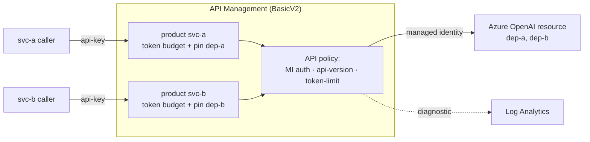

# APIM as an AI Gateway — Step by Step

Put Azure API Management in front of Azure OpenAI and turn on the LLM-aware controls. This is the
foundation for the gateway labs (03, 07, 08) and the safety lab (04).

> **🧒 In plain words.** We're hiring the **guard** and teaching them the house rules: check IDs,
> count how much each guest uses, block rude guests, keep a logbook, and send everyone to the right
> room — without ever handing out the master key.

Prereqs: finish [setup/prerequisites.md](../setup/prerequisites.md) (resource `$AOAI`, deployments
`$DEP_A`/`$DEP_B`).

---

## Step 1 — Create APIM with a managed identity

```bash
az apim create -n "$APIM" -g "$RG" -l "$LOC" \
  --publisher-email you@example.com --publisher-name "AI Labs" \
  --sku-name BasicV2            # token-limit & caching need BasicV2+ (NOT Consumption)

# system-assigned managed identity (the guard's own badge)
az apim update -n "$APIM" -g "$RG" --set identity.type=SystemAssigned
export APIM_MI=$(az apim show -n "$APIM" -g "$RG" --query identity.principalId -o tsv)
```

> **🧒 Why a managed identity?** So the guard proves who *they* are to the model, instead of
> carrying the house master key around. No secrets to leak.

## Step 2 — Let APIM call Azure OpenAI (no keys)

Grant the APIM identity data-plane access **at the resource** (remember [lab-01](../labs/lab-01-rbac-boundary.md):
access is resource-scoped):

```bash
export AOAI_ID=$(az cognitiveservices account show -n "$AOAI" -g "$RG" --query id -o tsv)
az role assignment create --assignee "$APIM_MI" \
  --role "Cognitive Services OpenAI User" --scope "$AOAI_ID"
```

## Step 3 — Import Azure OpenAI as an API

Point the API's backend at the resource's `/openai` path:

```bash
az apim api create -n "$APIM" -g "$RG" --api-id aoai \
  --display-name "Azure OpenAI" --path aoai --protocols https \
  --service-url "$AOAI_EP/openai" \
  --subscription-required true
```

Set the subscription-key header name. **Gotcha:** this environment used `api-key` (not the default
`Ocp-Apim-Subscription-Key`). Configure it explicitly so callers know what to send:

```bash
# via REST/portal: subscriptionKeyParameterNames = { header: "api-key", query: "subscription-key" }
```

## Step 4 — Apply the inbound policy

Attach [policies/aoai-api-inbound.xml](policies/aoai-api-inbound.xml) at API scope. It:

1. authenticates to the backend with the managed identity,
2. pins `api-version=2024-10-21`,
3. applies a per-subscription token limit.

```bash
az apim api policy create -n "$APIM" -g "$RG" --api-id aoai \
  --xml-path ./policies/aoai-api-inbound.xml   # or paste in the portal
```

## Step 5 — Products & subscriptions (per-service isolation)

Create one product per service so each gets its **own token budget** and can be pinned to its
deployment:

```bash
for S in svc-a svc-b; do
  az apim product create -n "$APIM" -g "$RG" --product-id "$S" \
    --display-name "$S" --subscription-required true --state published
  az apim product api add -n "$APIM" -g "$RG" --product-id "$S" --api-id aoai
done
```

> **Per-service deployment pinning.** Add a product-scope policy that rewrites the path to a fixed
> deployment, e.g. `<rewrite-uri template="/deployments/dep-a/chat/completions" />` for `svc-a`.
> This is how the gateway compensates for AOAI not enforcing per-deployment access.
> **Caution:** a broad `rewrite-uri` rewrites *all* paths — it will break `/responses`. Use a
> standalone API for Responses (see [lab-03](../labs/lab-03-store-false-apim.md)).

Get a subscription key to call through APIM:

```bash
# list the product subscription's primary key via REST listSecrets, then:
curl -sS "https://$APIM.azure-api.net/aoai/chat/completions" \
  -H "api-key: <PRODUCT_SUB_KEY>" -H "Content-Type: application/json" \
  -d '{"messages":[{"role":"user","content":"hi"}]}' -w '\nHTTP %{http_code}\n'
```

---

## Step 6 — Turn on the controls (the labs)

| Control | Policy | Lab |
|---------|--------|-----|
| Token rate limit → 429 | [token-limit.xml](policies/token-limit.xml) | [07](../labs/lab-07-token-limit.md) |
| Force `store=false` | [store-false.xml](policies/store-false.xml) | [03](../labs/lab-03-store-false-apim.md) |
| Prompt Shields → 400 | [prompt-shields.xml](policies/prompt-shields.xml) | [04](../labs/lab-04-prompt-shields.md) |
| Log prompts/responses/tokens | diagnostic settings | [08](../labs/lab-08-llm-logging.md) |

---

## Architecture



---

## Tier matters

| Capability | Consumption | BasicV2+ |
|------------|:-----------:|:--------:|
| Basic routing / auth | ✅ | ✅ |
| `llm-token-limit` | ❌ | ✅ |
| Semantic caching | ❌ | ✅ |

Pick **BasicV2 or higher** for the gateway labs.

> **Reference:** [GenAI gateway with APIM](https://learn.microsoft.com/en-us/ai/playbook/solutions/genai-gateway/reference-architectures/apim-based) ·
> [APIM LLM policies](https://learn.microsoft.com/en-us/azure/api-management/genai-gateway-capabilities). Confirmed 2026-10.
