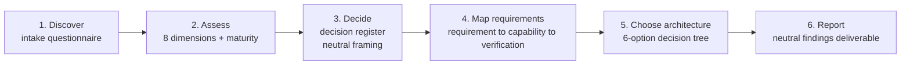

# AI Landing Zone — Consulting Framework

A practical system for **running an Azure AI Landing Zone engagement with a customer** — and the
fill-in templates to do it. This is Part B of the repo. Part A ([`../labs/`](../labs/)) proves how
the platform actually behaves; Part B turns that proof into a structured conversation with a
customer.

> **Why a separate framework?** A *platform* landing zone is mostly infrastructure and
> infra-security — networking, identity, policy, connectivity. An *AI* landing zone has a
> different grain. Its real subject is **data, models, prompts, tokens, behavior, safety and
> cost** — things an infrastructure checklist never captures. See
> [why AI LZ is different](#-why-ai-lz-is-different-from-a-platform-lz).

---

## 🧒 In plain words

Building the *infrastructure* for AI is like **building a safe building** — walls, locks, doors,
cameras. Important, but it's just the building.

Consulting on an *AI landing zone* is like being the **restaurant consultant**, not the
construction inspector. You ask: *What food (data) are you serving? Who is allowed to eat (access)?
How much will each dish cost (tokens)? What if the chef says something rude (safety)? Can the
kitchen keep up at dinner rush (capacity)? Is any ingredient illegal here (regulation)?*

Those questions have nothing to do with bricks. That's the difference.

---

## 🧭 Why AI LZ is different from a platform LZ

| Axis | Platform Landing Zone | AI Landing Zone |
|------|-----------------------|-----------------|
| Unit of concern | Infra resources (VNet, subscription, policy) | **Data, prompts, models, tokens, behavior** |
| Risk type | Breach, misconfiguration | **+ harmful output, data leakage via prompts, hallucination, runaway cost, regulation (PII / residency)** |
| Change cadence | Slow (build once, maintain) | **Fast** (models version monthly, prompts change daily) |
| Cost model | Capacity / VM billing | **Token economics** (PTU vs PAYG, per-model price) |
| Ownership | Central platform team | **Split** — central gateway + per-team agents |
| Success metric | "Is the environment compliant and connected?" | **"Is the AI's behavior governed, evaluated, affordable and compliant per use case?"** |

Infra security is the **floor** the AI landing zone stands on — assumed, not the point. The point
is the AI-specific dimensions below.

---

## 📐 The eight dimensions

The framework assesses an AI landing zone across eight dimensions. They are ordered: the earlier
ones constrain the later ones (you cannot choose capacity before you know the data boundary).

| # | Dimension | Core question | Proven by lab |
|---|-----------|---------------|---------------|
| D1 | **Data & regulatory boundary** | Where must this data be processed, and what class is it? | — (drives everything) |
| D2 | **Model & capacity strategy** | Which models, and reserved (PTU) or pay-as-you-go? | [10](../labs/lab-10-datazone.md), [12](../labs/lab-12-ptu-quota-pricing.md) |
| D3 | **Isolation & multitenancy** | Shared or dedicated resources/deployments per service? | [01](../labs/lab-01-rbac-boundary.md), [02](../labs/lab-02-content-filter.md) |
| D4 | **AI gateway governance** | How are access, cost, routing and quota centrally controlled? | [03](../labs/lab-03-store-false-apim.md), [07](../labs/lab-07-token-limit.md), [08](../labs/lab-08-llm-logging.md) |
| D5 | **Responsible AI & safety** | How are harmful prompts/outputs and PII handled? | [04](../labs/lab-04-prompt-shields.md), [09](../labs/lab-09-pii-redaction.md) |
| D6 | **Data protection & keys** | What is stored, encrypted how, readable by whom? | [03](../labs/lab-03-store-false-apim.md), [05](../labs/lab-05-responses-crossread.md), [11](../labs/lab-11-cmk.md) |
| D7 | **Observability & audit** | Can you see who asked what, cost, and quality? | [08](../labs/lab-08-llm-logging.md) |
| D8 | **Agent architecture & identity** | How do agents orchestrate, remember, and authenticate? | Agent Zone ([concepts](../docs/ai-landing-zone.md)) |

Full detail for each dimension — plain-words intro, discovery questions, platform behaviors,
decision points (neutral framing), and a 0–3 maturity scale — is in
**[framework.md](framework.md)**.

---

## 🔁 How an engagement runs

Each step has a ready template under [`templates/`](templates/):

| Step | Template | Purpose |
|------|----------|---------|
| 1. Discover | [discovery-questionnaire.md](templates/discovery-questionnaire.md) | Capture the customer's data, services, constraints |
| 2. Assess | [dimension-assessment.md](templates/dimension-assessment.md) | Score current vs target maturity per dimension |
| 3. Decide | [decision-register.csv](templates/decision-register.csv) | One row per decision: options, criteria, who decides |
| 4. Map | [requirements-matrix.csv](templates/requirements-matrix.csv) | Requirement → platform capability → verification status |
| 5. Choose | [../docs/decision-tree.md](../docs/decision-tree.md) | Pick one of six target configurations |
| — Roles | [raci.md](templates/raci.md) | Platform team vs app team vs customer responsibilities |
| 6. Report | [findings-report.md](templates/findings-report.md) | Neutral findings + what the customer must decide |

---

## 🧰 The neutral-framing rule (important)

Customer-facing output in this framework is written **neutrally**. You present:

- the **platform's behavior, constraints, and options**, and the **criteria** to judge them;
- items the customer must decide in a **separate column**, not mixed into statements of fact;
- confidence as a **badge** — `Verified (live)` / `Documented` / `Needs confirmation` — not fuzzy
  wording;
- any design judgment **with its source** ("no pattern in reference architecture — design call").

You are not there to declare right and wrong. You provide an unbiased view and the Microsoft
best-practice baseline, so the customer can bring their own input to the internal discussion.

---

*This framework is a consulting companion built on live-verified platform behavior. It is not
official Microsoft methodology; it organizes CAF (AI) and WAF guidance into a repeatable
engagement. Cite Microsoft Learn for any specific claim.*
