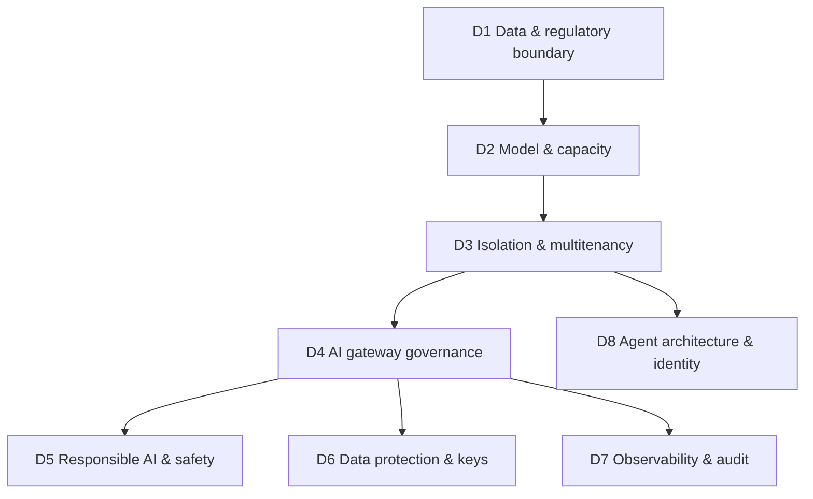

# The Eight Dimensions — Detailed Framework

This is the working reference for an AI Landing Zone assessment. For each dimension you get:

- **🧒 In plain words** — the idea with no jargon
- **Why it isn't just infra** — what a platform-LZ checklist misses
- **Discover** — questions to ask the customer
- **Platform behavior** — what Azure actually does (linked to the verified lab)
- **Decide (neutral)** — options, the criteria to judge them, and what the *customer* must decide
- **Maturity 0–3** — a scale to score current vs target

The dimensions are ordered. **D1 constrains D2, which constrains D3**, and so on. Always assess
top-down.

---

## D1 — Data & regulatory boundary

**🧒 In plain words.** Before anything else: *what kind of food are you cooking, and is it legal
to cook it here?* Some data is so sensitive it may only be processed in one country or one region.

**Why it isn't just infra.** Networking can isolate traffic, but it cannot tell you whether a
customer's resident-registration number is allowed to leave Korea. That is a data-classification
and regulation question, not a firewall rule.

**Discover.**
- What data classes flow into prompts? (public, internal, personal/PII, regulated/"Type2", secret)
- Does any regulation pin processing to a region or sovereign boundary?
- Is de-identified data still in scope, per the customer's own policy?
- Who owns the data-classification decision on the customer side?

**Platform behavior.**
- Region availability differs by model and deployment type. Korea Central exposes **DataZone
  Standard (10 models)** and **DataZone PTU (2 models)** — verified in
  [lab-10](../labs/lab-10-datazone.md).
- PII detection (Azure AI Language) depends on the `language` parameter and is **not 100%** —
  verified in [lab-09](../labs/lab-09-pii-redaction.md).

**Decide (neutral).**

| Option | When it fits | Customer must decide |
|--------|--------------|----------------------|
| Regional (in-country) processing | Regulation pins the region | Is de-identified data still in scope? |
| DataZone | Regional capacity gap, zone-level residency acceptable | Is the DataZone boundary acceptable to compliance? |
| Global (PAYG/PTU) | Data is de-scoped / not regulated | Does security accept global processing? |

**Maturity.** 0: data classes unknown · 1: classes listed · 2: each class mapped to a region/zone
rule · 3: enforced by policy + verified routing.

---

## D2 — Model & capacity strategy

**🧒 In plain words.** Do you *hire the assistant full-time* (reserved capacity, pays off if busy)
or *pay per question* (cheap when quiet, pricey at scale)? And which assistant — the fast cheap one
or the deep expensive one?

**Why it isn't just infra.** This is **token economics**, not VM sizing. Price is per-model and
per-token; capacity is measured in PTU, not cores; models change version monthly.

**Discover.**
- Expected tokens/min at peak, per service? Latency target?
- Steady traffic (favors PTU) or spiky/low (favors PAYG)?
- Which models, and who owns model-version upgrades?
- Budget owner and cost-allocation model?

**Platform behavior.**
- PTU minimum and increment are **per model**; quota is per subscription × region × deployment
  type; price is per model — see [lab-12](../labs/lab-12-ptu-quota-pricing.md).
- A single small service may need well under one PTU of real load, so sharing matters (feeds D3).

**Decide (neutral).**

| Option | When it fits | Customer must decide |
|--------|--------------|----------------------|
| PAYG (Global/Regional Standard) | Spiky or low volume, no capacity guarantee needed | Is a latency/throughput SLA required? |
| PTU (Provisioned) | Steady high volume, predictable cost, throughput guarantee | Can utilization justify the minimum PTU? |
| Mixed (PTU base + PAYG burst) | Steady floor with spikes | Spillover routing owned by whom? |

**Maturity.** 0: no capacity model · 1: volume estimated · 2: PTU/PAYG chosen per service with
utilization math · 3: utilization monitored, spillover automated.

---

## D3 — Isolation & multitenancy

**🧒 In plain words.** One shared room for all teams, or a private room each? Sharing is cheaper;
private is safer and more independent.

**Why it isn't just infra.** The isolation boundary here is the **Azure OpenAI resource**, and it
decides permissions, keys, encryption and blast radius — all at once. A generic "one subscription
per app" rule misses that deployments inside one resource share auth.

**Discover.**
- How many services/teams share this platform? Do their policies differ?
- Must any service own its own permissions, keys, or failure domain?
- Who manages resource settings — central platform or each app team?

**Platform behavior.**
- Data-plane **permissions are at the resource**, not the deployment — a per-deployment role grant
  is accepted by ARM but gives no access ([lab-01](../labs/lab-01-rbac-boundary.md)).
- **Content filters / blocklists are per deployment** ([lab-02](../labs/lab-02-content-filter.md)),
  so one resource can host services with different filter policies.
- CMK is a **resource-level** control ([lab-11](../labs/lab-11-cmk.md)).

**Decide (neutral).** Use the [6-option decision tree](../docs/decision-tree.md). The tree's Q2–Q4
*are* this dimension: Q2 = dedicated resource?, Q3/Q4 = shared vs dedicated deployment.

**Maturity.** 0: ad-hoc resources · 1: boundary rationale written · 2: shared/dedicated chosen per
service against the tree · 3: enforced, with gateway compensating for shared-resource auth (D4).

---

## D4 — AI gateway governance

**🧒 In plain words.** The **front desk with a guard** everyone passes. The guard checks you in,
counts how much you've used, blocks overuse, logs the visit, and sends you to the right room.

**Why it isn't just infra.** A load balancer moves packets; it does not count LLM tokens, force
`store=false`, or inspect a prompt for a jailbreak. The AI gateway is an **application-behavior**
control point.

**Discover.**
- Do services need central token limits, routing, logging, or safety checks?
- Is there a shared gateway team, or does each app manage its own access?
- Which APIM tier? (token-limit and semantic-caching need Basic v2 or higher, **not** Consumption.)

**Platform behavior.**
- APIM can **force `store=false`** regardless of client ([lab-03](../labs/lab-03-store-false-apim.md)).
- APIM **token rate limiting** returns 429 with `Retry-After`
  ([lab-07](../labs/lab-07-token-limit.md)); counter is per subscription.
- APIM logs **prompts, responses and token counts** to Log Analytics
  ([lab-08](../labs/lab-08-llm-logging.md)).
- Because AOAI does not enforce per-deployment access (D3), **the gateway is what pins each service
  to its deployment**. Full setup in [apim-guide](../apim/apim-guide.md).

**Decide (neutral).**

| Option | When it fits | Customer must decide |
|--------|--------------|----------------------|
| Shared APIM in front of all services | Shared resources (tree ①–③), central policy needed | Which team owns gateway policy? |
| Dedicated resource, direct (no APIM) | Service fully owns its resource and needs no shared policy | Who enforces token/logging then? |
| Dedicated resource + shared APIM | Isolation *and* common policy | Gateway subscription vs workload subscription split? |

**Maturity.** 0: direct client access · 1: APIM in path · 2: token limit + logging + routing
policies applied per service · 3: safety policies (D5) + cost dashboards (D7) integrated.

---

## D5 — Responsible AI & safety

**🧒 In plain words.** *What if the assistant is tricked into saying something bad, or repeats a
secret?* You need a bouncer for prompts and a marker that hides private details.

**Why it isn't just infra.** Firewalls do not understand language. Catching a jailbreak or masking
a resident-registration number is a **content** problem solved by AI services, not network rules.

**Discover.**
- What harmful-content categories must be blocked? Any sector rules?
- Is PII masking required before the prompt reaches the model? Which languages?
- Is abuse monitoring / human review required or must it be opted out for privacy?

**Platform behavior.**
- **Prompt Shields** (Content Safety) detect jailbreak/injection; benign → false, jailbreak → true
  ([lab-04](../labs/lab-04-prompt-shields.md)). APIM can call it and block (400).
- **PII masking** (Azure AI Language) needs `language=ko` for Korean and still misses some entities
  (e.g. bank account) — [lab-09](../labs/lab-09-pii-redaction.md). Detection is **not 100%**.
- Content Safety ≠ PII: harm/jailbreak/blocklists only, no entity recognition. The newer AI Gateway
  tier has **no native PII policy**.

**Decide (neutral).**

| Option | When it fits | Customer must decide |
|--------|--------------|----------------------|
| Content Safety at gateway (harm + shields) | Block harmful/jailbreak centrally | Threshold per category? |
| PII masking layer (Function + AI Language) | Personal data in prompts | Accept non-100% detection? Fallback? |
| Abuse-monitoring opt-out | Strict privacy needs | Trade monitoring for privacy — approved? |

**Maturity.** 0: none · 1: content filter defaults on · 2: shields + PII layer in path, `language`
set correctly · 3: measured (false-positive/negative tracked), reviewed periodically.

---

## D6 — Data protection & keys

**🧒 In plain words.** *What gets written down, locked in whose safe, and who can open it?* If you
never write it down, you need no safe.

**Why it isn't just infra.** Storage encryption is infra; but *whether a prompt is stored at all*,
and *whether one caller can read another's stored answer*, are AI-behavior questions.

**Discover.**
- Must prompts/responses be persisted, or is "no storage" preferred?
- Is customer-managed-key (CMK) encryption required? By which regulation?
- Retention period and access-control requirements for any stored content?

**Platform behavior.**
- APIM can force **no persistence** (`store=false`, [lab-03](../labs/lab-03-store-false-apim.md)).
  No storage → no CMK requirement for that path.
- Stored Responses are **not isolated by caller** — any resource-scope identity can read another's
  response by id ([lab-05](../labs/lab-05-responses-crossread.md)). Governance flag for `store=true`.
- **CMK key must be in the same region** as the resource and is **resource-scoped**, not
  per-deployment ([lab-11](../labs/lab-11-cmk.md)).

**Decide (neutral).**

| Option | When it fits | Customer must decide |
|--------|--------------|----------------------|
| `store=false` everywhere | No business need to persist | Lose Responses continuity — acceptable? |
| `store=true` + access governance | Need stored threads | Accept cross-identity read risk / add controls? |
| CMK on stored services | Regulation requires customer keys | Same-region key vault + rotation owner? |

**Maturity.** 0: unknown storage posture · 1: store flag decided per path · 2: CMK where required,
same-region · 3: retention + access + cross-read risk all controlled and audited.

---

## D7 — Observability & audit

**🧒 In plain words.** *Can you see who asked what, how much it cost, and whether the answer was
any good?* If you can't see it, you can't govern it.

**Why it isn't just infra.** Infra monitoring watches CPU and errors. AI observability watches
**prompts, responses, tokens, cost and answer quality** — a different telemetry entirely.

**Discover.**
- Is prompt/response body logging required, allowed, or forbidden (privacy)?
- Cost reporting granularity — per service, per team, per model?
- Is answer-quality evaluation (groundedness, drift) in scope?

**Platform behavior.**
- APIM logs prompts, responses and **token counts** to Log Analytics (opt-in body logging),
  resource-specific table ([lab-08](../labs/lab-08-llm-logging.md)).
- Logs can also route to Storage; in a locked tenant that needs a private endpoint to read
  (environment constraint, see lab-08 notes).

**Decide (neutral).**

| Option | When it fits | Customer must decide |
|--------|--------------|----------------------|
| Token-only logging | Cost/usage visibility, privacy-sensitive | Is body logging forbidden? |
| Full body logging | Debugging, audit, quality eval | Retention + CMK on the log store? |
| + Evaluation pipeline | Quality/groundedness matters | Who owns eval datasets and thresholds? |

**Maturity.** 0: no AI telemetry · 1: token usage visible · 2: body logging + cost per service · 3:
evaluation + drift monitoring in place.

---

## D8 — Agent architecture & identity

**🧒 In plain words.** The **robot workshop**. A robot needs a brain (model), a notebook of facts
(search), a memory (database), a workspace (compute), and an ID badge to prove who it is.

**Why it isn't just infra.** Agents add orchestration, memory, tools and *machine identity* —
concepts that don't exist in a plain platform landing zone.

**Discover.**
- Single prompt-in/out, or multi-step agents with tools and memory?
- How do agents authenticate to the model and to data (managed identity, on-behalf-of)?
- Where does grounding data live, and what is its boundary (back to D1)?

**Platform behavior.**
- This is the **Agent Zone** — Foundry model + AI Search (RAG) + Cosmos DB (memory) + Container
  Apps (runtime), behind the gateway. See [ai-landing-zone](../docs/ai-landing-zone.md).
- Agents should call the model via **managed identity through the gateway**, inheriting all gateway
  controls (D4–D7).

**Decide (neutral).**

| Option | When it fits | Customer must decide |
|--------|--------------|----------------------|
| Model API only (no agent) | Simple prompt/response | Does the app assemble RAG itself? |
| Managed agent (Foundry Agent) | Tools + memory + orchestration needed | Data boundary for memory/search (D1)? |
| Multi-agent | Complex workflows | Per-agent identity and gateway routing? |

**Maturity.** 0: direct keys from app · 1: managed identity to model · 2: agent via gateway with
RAG boundary set · 3: per-agent identity, evaluated, memory governed.

---

## Scoring sheet

Copy [templates/dimension-assessment.md](templates/dimension-assessment.md), score each dimension
**current (0–3)** and **target (0–3)**, and the gaps become your backlog. Pair every gap with a row
in the [decision register](templates/decision-register.csv) and the
[requirements matrix](templates/requirements-matrix.csv).
