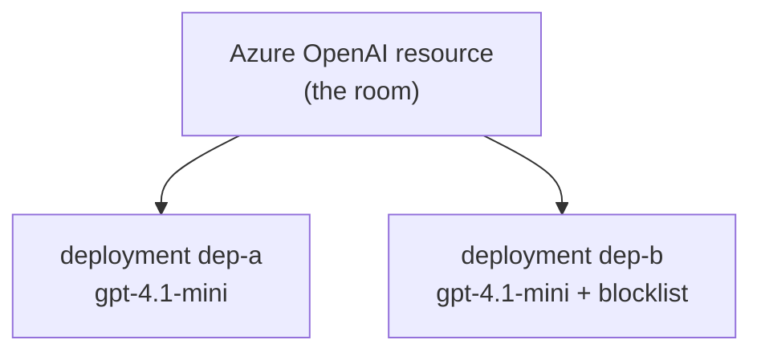
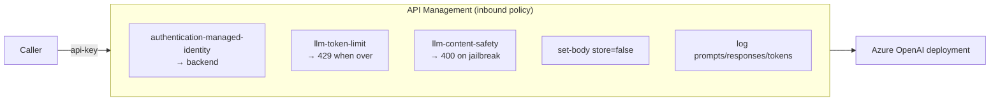

# Core Concepts

The vocabulary you need before the labs. Each concept: plain words first, then the real thing.

---

## 1. Resource vs Deployment

**🧒 In plain words.** A **resource** is a *room*; a **deployment** is a *desk* inside it. You put
one model at each desk. Several desks can share one room.

**The real thing.** An **Azure OpenAI resource** (a Cognitive Services account) is the security and
management boundary. Inside it you create **deployments**, each binding one model + version +
capacity + content filter.

**What is shared vs separate** (this is the whole point, and the labs prove it):

| Attribute | Boundary | Lab |
|-----------|----------|-----|
| Permissions (RBAC), keys | **Resource** (shared by all deployments) | [01](../labs/lab-01-rbac-boundary.md) |
| Encryption (CMK) | **Resource** | [11](../labs/lab-11-cmk.md) |
| Content filter / blocklist | **Deployment** (independent) | [02](../labs/lab-02-content-filter.md) |
| Model, version, capacity | **Deployment** | [12](../labs/lab-12-ptu-quota-pricing.md) |

> **Consequence:** you cannot give one service access to only *one* deployment of a shared
> resource. Access is all-or-nothing at the resource. That is why a gateway (APIM) is used to pin
> each service to its deployment — [lab-01](../labs/lab-01-rbac-boundary.md), [apim-guide](../apim/apim-guide.md).

---

## 2. PTU vs PAYG

**🧒 In plain words.** **PTU** = *hire the assistant full-time* (fixed monthly cost, always
available). **PAYG** = *pay per question* (cheap when quiet, adds up when busy).

**The real thing.**

| | PAYG (Standard) | PTU (Provisioned) |
|-|-----------------|-------------------|
| Billing | Per token used | Reserved capacity (per PTU) |
| Throughput | Best-effort, shared | Guaranteed |
| Latency | No SLA (add Priority) | Predictable |
| Best for | Spiky / low volume | Steady / high volume |
| Minimum | None | Per-model minimum PTU |

**Deployment types** you'll meet: `GlobalStandard`, `Standard` (regional), `DataZoneStandard`,
`GlobalProvisionedManaged`, `ProvisionedManaged` (regional PTU), `DataZoneProvisionedManaged`.
Which exist depends on region + model — [lab-10](../labs/lab-10-datazone.md),
[lab-12](../labs/lab-12-ptu-quota-pricing.md).

---

## 3. Data-plane vs control-plane

**🧒 In plain words.** The **control plane** is *building and furnishing the room* (create
resource, create deployment). The **data plane** is *actually talking to the assistant* (send a
prompt, get an answer). Being allowed to build a room is not the same as being allowed to talk.

**The real thing.** Control-plane = ARM/management APIs (`az cognitiveservices ...`). Data-plane =
the inference endpoint (`POST /openai/deployments/{dep}/chat/completions`). They use **different
authorization**. A role scoped to a deployment is accepted by ARM but the **data plane authorizes
at the resource** — proven in [lab-01](../labs/lab-01-rbac-boundary.md).

---

## 4. APIM as an AI gateway

**🧒 In plain words.** The **front desk with a guard**. Everyone passes it; the guard applies the
rules.

**The real thing.** Azure API Management sits in front of the model endpoints and applies
**LLM-aware policies**:

Key policies you'll configure: `authentication-managed-identity`, `llm-token-limit`,
`llm-content-safety`, `set-body` (store), plus diagnostic logging. Full walkthrough in
[apim-guide](../apim/apim-guide.md).

> **Gotcha (from the live run):** the APIM subscription-key header in this environment is named
> **`api-key`**, not the default `Ocp-Apim-Subscription-Key`. The query form `?subscription-key=`
> also works. A missing/renamed key returns 401.

---

## 5. Store, caching, and Responses API

**🧒 In plain words.** The assistant can **remember** an answer so you can fetch it later
(`store=true`), and it can **reuse** a repeated long question to go faster (caching).

**The real thing.**
- **`store`** controls whether a Responses-API call is persisted server-side. APIM can force it
  off — [lab-03](../labs/lab-03-store-false-apim.md). Stored responses are **not caller-isolated** —
  [lab-05](../labs/lab-05-responses-crossread.md).
- **Prompt caching** is automatic for identical prefixes > ~1024 tokens; the second call reports
  `cached_tokens > 0` — [lab-06](../labs/lab-06-prompt-caching.md).

---

## 6. The safety & privacy services

**🧒 In plain words.** A **bouncer for prompts** (Content Safety / Prompt Shields) and a **marker
that hides private details** (PII masking). They are different tools for different jobs.

**The real thing.**
- **Azure AI Content Safety** — harm categories, **Prompt Shields** (jailbreak/injection),
  blocklists. No entity recognition — [lab-04](../labs/lab-04-prompt-shields.md).
- **Azure AI Language — PII** — detects/masks entities; needs the right `language`; not 100% —
  [lab-09](../labs/lab-09-pii-redaction.md).
- **Content Safety ≠ PII.** You need both for a full safety story.

---

Next: [setup/prerequisites.md](../setup/prerequisites.md) to build the environment.
