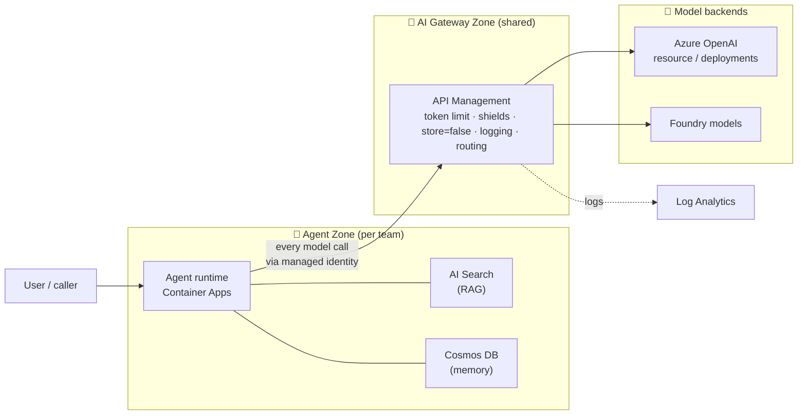

# AI Landing Zone — Gateway Zone & Agent Zone

The map of the whole territory. Read this first; every lab is a close-up of one part of it.

---

## 🧒 In plain words

Think of an enterprise AI setup as a **LEGO city**.

- 🤖 The **Agent Zone** is the **robot workshop** — where the smart helpers (agents) live. Each
  robot has a **brain** (the model), a **reference book** (search over company data), a **diary**
  (memory of past chats), and a **workbench** (compute to run on).
- 🚪 The **AI Gateway Zone** is the **front gate with a guard** — every robot that wants to talk to
  the big brain must pass the guard, who checks *who you are, how much you've used, and whether
  you're saying anything unsafe*, then writes the visit in a logbook.

**Why split them?** The **guard is shared by everyone** (one gate, one rulebook), while the
**robots belong to different teams** (each builds its own). Central control + team freedom.

---

## 🧠 The two zones, for real

Microsoft's current AI landing zone reference splits into two independently-deployable zones.

### 🚪 AI Gateway Zone

A centralized, policy-enforced entry point for **all** AI traffic. Built on **Azure API
Management**. It gives you LLM-aware controls that generic infrastructure cannot:

- **Token-based rate limiting** — counts prompt + completion tokens, not just requests → [lab-07](../labs/lab-07-token-limit.md)
- **Content safety / Prompt Shields** — central jailbreak & harm checkpoint → [lab-04](../labs/lab-04-prompt-shields.md)
- **Persistence control** — force `store=false` → [lab-03](../labs/lab-03-store-false-apim.md)
- **Logging** — prompts, responses, token counts → [lab-08](../labs/lab-08-llm-logging.md)
- **Routing, load balancing, semantic caching, managed-identity auth** to the backend models

### 🤖 Agent Zone

Where agents are built and run, using Microsoft Foundry + the agent runtime. Core components:

| Component | Role (plain words) | Azure service |
|-----------|--------------------|---------------|
| Brain | Thinks / generates | Microsoft Foundry model (Azure OpenAI) |
| Reference book | Finds company facts (RAG) | Azure AI Search |
| Diary | Remembers the conversation | Azure Cosmos DB |
| Workbench | Runs the agent logic | Azure Container Apps |
| Supplies | Secrets, config, files, telemetry | Key Vault, App Config, Storage, App Insights, Log Analytics |

All of it sits inside a secured VNet with private endpoints — that's the **platform landing zone
floor** underneath (see [consulting framework](../consulting/README.md) for why that floor is
assumed, not the point).

---

## 🗺️ How they fit together

**The golden rule:** agents never call the model directly — **every call goes through the gateway**,
so it inherits token limits, safety, persistence control and logging automatically.

---

## 🧩 Which lab lives in which zone

| Zone | Labs | Theme |
|------|------|-------|
| 🚪 Gateway Zone | [03](../labs/lab-03-store-false-apim.md), [04](../labs/lab-04-prompt-shields.md), [07](../labs/lab-07-token-limit.md), [08](../labs/lab-08-llm-logging.md), [09](../labs/lab-09-pii-redaction.md) | What the guard does |
| 🤖 Agent Zone | [01](../labs/lab-01-rbac-boundary.md), [02](../labs/lab-02-content-filter.md), [05](../labs/lab-05-responses-crossread.md), [06](../labs/lab-06-prompt-caching.md), [10](../labs/lab-10-datazone.md), [11](../labs/lab-11-cmk.md), [12](../labs/lab-12-ptu-quota-pricing.md) | How the robot brains are organized |

---

## Why "landing zone" at all?

A **landing zone** is a pre-built, governed place where a workload "lands" — guardrails first, then
the workload. The **platform** landing zone gives the floor (network, identity, policy). The **AI**
landing zone adds the two AI-specific zones above. The split lets the platform team own the shared
gate while each app team owns its robots.

> **Sources:** [Azure/AI-Landing-Zones](https://github.com/Azure/AI-Landing-Zones) ·
> [Azure/agent-landing-zone](https://github.com/Azure/agent-landing-zone) ·
> [GenAI gateway reference architecture (APIM)](https://learn.microsoft.com/en-us/ai/playbook/solutions/genai-gateway/reference-architectures/apim-based) ·
> [CAF — AI Ready](https://learn.microsoft.com/en-us/azure/cloud-adoption-framework/ai/ready).
> Confirmed 2026-10.
