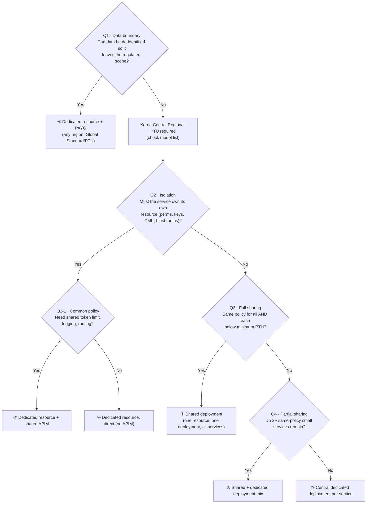

# Decision Tree — Choosing a Target Configuration

Six target configurations (①–⑥). Answer top-down; each "yes" sends you right to a configuration,
each "no" drops you to the next question. This is the design output of framework dimensions D1
(data boundary), D3 (isolation) and D4 (gateway).

> **🧒 In plain words.** Like a "choose your own adventure" book. Start at the top, answer each
> question, and the arrows lead you to exactly one ending (a configuration). Every path ends
> somewhere — nobody gets stuck.

---

## The tree

---

## The six configurations

| # | Name | When you land here | Isolation | Gateway |
|---|------|--------------------|-----------|---------|
| ① | Shared deployment | Everyone same policy, all tiny | Lowest (shared desk) | Recommended |
| ② | Shared + dedicated mix | Some tiny same-policy, some not | Medium | Recommended |
| ③ | Central dedicated deployment | Shared resource, own desks | Medium | Recommended |
| ④ | Dedicated resource, direct | Service owns room, no shared policy | High | None |
| ⑤ | Dedicated resource + shared APIM | Own room **and** common policy | High | Shared |
| ⑥ | Dedicated resource + PAYG | Data de-scoped, region-free | High | Optional |

---

## Why this order (the logic)

**🧒 In plain words.** Ask the *strongest wall* first. If a service needs its own room, it can't
share a desk — so decide the room before the desk.

The order is sound and matches verified platform behavior:

1. **Q1 first — data boundary** is a hard regulatory constraint; it decides region and deployment
   type before anything else ([lab-10](../labs/lab-10-datazone.md), [lab-09](../labs/lab-09-pii-redaction.md)).
2. **Q2 before Q3/Q4 — resource isolation before deployment sharing.** Permissions, keys and CMK
   are *resource*-scoped ([lab-01](../labs/lab-01-rbac-boundary.md), [lab-11](../labs/lab-11-cmk.md)),
   so a service needing its own resource can't share a deployment. Decide the resource first.
3. **Q3/Q4 — deployment sharing.** Content filters are *per deployment*
   ([lab-02](../labs/lab-02-content-filter.md)), so services with different filter/model/lifecycle
   needs get their own deployment even inside a shared resource.

### Soundness check

- **Complete:** every path ends at one of ①–⑥; no dead ends.
- **Mutually exclusive:** each node is a yes/no, so branches don't overlap.
- **Consistent:** the branch rationales are the verified lab facts, not opinion.

### Two things to apply carefully (not errors)

- **Granularity shift.** Q1–Q2 are asked *per service*; Q3–Q4 are *per group*. When requirements
  mix, peel off the Q2-"yes" services to ④/⑤, then run the rest from Q3. Example: service A → ⑤,
  services B·C → ①.
- **Q3 is a compound AND** — "same policy AND below minimum PTU". If policies differ, answer no
  regardless of size.

---

## APIM note

Configurations ①–③ share a resource, so a gateway is recommended: because Azure OpenAI does not
enforce per-deployment access ([lab-01](../labs/lab-01-rbac-boundary.md)), APIM is what pins each
service to its deployment and adds token limits, logging and safety. See
[apim-guide](../apim/apim-guide.md).

> **Reference:** Provisioned throughput for Foundry Models · Region availability · Multitenancy and
> Azure OpenAI · Use a gateway in front of multiple Azure OpenAI deployments (Microsoft Learn,
> confirmed 2026-10).
