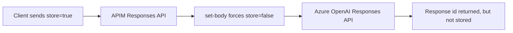

# Lab 03 — Gateway-enforced No Persistence

**Zone:** 🚪 Gateway · **Dimension:** D6 Data protection (and D4) · **Evidence:** [evidence/20-store-false-apim.txt](../evidence/20-store-false-apim.txt)

---

## 🧒 In plain words

A guest may ask the assistant to save a note. But the front desk guard can stamp every request with
"do not save this." Even if the guest asks to save it, the guard changes the request before it
reaches the assistant.

## 🧠 The idea

The Responses API has a `store` flag that controls server-side persistence. If `store=true`, the
response can be read later by id. If `store=false`, it is not stored for later retrieval.

APIM can centrally enforce this. The policy in
[store-false.xml](../apim/policies/store-false.xml) uses `<set-body>` to overwrite the request body
so `store` is always `false`, regardless of what the client sent.

Gotcha: a product-scope `rewrite-uri` can break `/responses`. Use a standalone APIM API for
Responses, with `subscriptionRequired` set as needed, managed identity auth to the backend, and
`api-version=2025-03-01-preview`.



## 🔬 Try it

Prereq: [setup](../setup/prerequisites.md) done (`$AOAI_EP`, `$AOAI_KEY`, `$APIM`, `$RG`, `$DEP_A`).
The APIM Responses API uses the policy file
[store-false.xml](../apim/policies/store-false.xml).

**1. Call Azure OpenAI directly with `store=true`:**

```bash
export API_VER=2025-03-01-preview
export DIRECT_ID=$(curl -sS "$AOAI_EP/openai/responses?api-version=$API_VER" \
  -H "api-key: $AOAI_KEY" -H "Content-Type: application/json" \
  -d "{\"model\":\"$DEP_A\",\"input\":\"direct store test\",\"store\":true}" \
  | jq -r .id)
echo "direct id=$DIRECT_ID"
```

**2. Read the direct response by id:**

```bash
curl -s -o direct-get.json -w 'DIRECT GET -> HTTP %{http_code}\n' \
  "$AOAI_EP/openai/responses/$DIRECT_ID?api-version=$API_VER" \
  -H "api-key: $AOAI_KEY"
```

**3. Call through APIM while the client still sends `store=true`:**

```bash
export APIM_HOST=$(az apim show -n "$APIM" -g "$RG" --query gatewayUrl -o tsv)
export APIM_ID=$(curl -sS "$APIM_HOST/resptest/openai/responses?api-version=$API_VER" \
  -H "Content-Type: application/json" \
  -d "{\"model\":\"$DEP_A\",\"input\":\"apim store test\",\"store\":true}" \
  | jq -r .id)
echo "apim id=$APIM_ID"
```

**4. Try to read the APIM-created response directly by id:**

```bash
curl -s -o apim-get.json -w 'APIM-CREATED GET -> HTTP %{http_code}\n' \
  "$AOAI_EP/openai/responses/$APIM_ID?api-version=$API_VER" \
  -H "api-key: $AOAI_KEY"
rm -f direct-get.json apim-get.json
```

## 📊 What you'll see

```
=== store=false APIM enforcement ===
Policy on APIM resptest API: <set-body> forces body['store']=false; MI auth to backend.
[A] DIRECT to AOAI, store=true  -> id=resp_07af...ec55 ; GET by id -> 200 (STORED)
[B] THROUGH APIM, client store=true (policy->false) -> id=resp_0ddb...be3a ; GET by id -> 404 (NOT stored)
RESULT: APIM set-body policy overrides client store flag. Client cannot opt back into persistence.
```

## ✅ Why it matters

- APIM can enforce a central **no-persistence** rule.
- Clients cannot opt back into storage by sending `store=true`.
- For this path, no server-side response storage means no CMK requirement for stored responses; see
  [lab-11-cmk](../labs/lab-11-cmk.md).

## 📎 Evidence

[evidence/20-store-false-apim.txt](../evidence/20-store-false-apim.txt) — live capture: direct
`store=true` was retrievable; APIM-forced `store=false` returned 404 by id.

## 🧹 Cleanup

No lab-only Azure resources are created here. Remove the APIM Responses API or policy only if you
created it just for this test.

## 📚 References

- [Azure API Management set-body policy](https://learn.microsoft.com/en-us/azure/api-management/set-body-policy)
- [Azure OpenAI Responses API](https://learn.microsoft.com/en-us/azure/ai-services/openai/how-to/responses)

Confirmed 2026-10.
