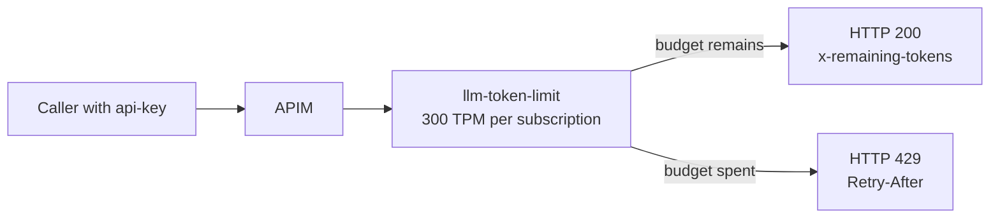

# Lab 07 — Per-subscription token limit

**Zone:** 🚪 Gateway · **Dimension:** D4 AI gateway governance · **Evidence:** [evidence/24-token-limit-429.txt](../evidence/24-token-limit-429.txt)

---

## 🧒 In plain words

Each guest gets a snack allowance. When a guest has used the allowance, the guard says "come back
later" and tells them how long to wait. Another guest has a separate allowance.

## 🧠 The idea

APIM can enforce an LLM token-per-minute budget with
[../apim/policies/token-limit.xml](../apim/policies/token-limit.xml). This lab uses:

```xml
<llm-token-limit counter-key="@(context.Subscription.Id)" tokens-per-minute="300">
```

The counter key is the APIM subscription ID, so `svc-a` and `svc-b` have independent budgets. The
policy is post-counted: one call can consume the remaining budget, and later calls are throttled.
When the budget is spent, APIM returns HTTP 429 with `Retry-After`.

This policy requires BasicV2 or higher. It is not supported on the Consumption tier.



## 🔬 Try it

Prereq: [setup](../setup/prerequisites.md) done and [APIM setup](../apim/apim-guide.md) done
(`$RG`, `$APIM`, `$DEP_A`). The API ID is `aoai`, and the gateway uses the `api-key` header.

**1. Apply the token-limit policy:**

```bash
az apim api policy create -n "$APIM" -g "$RG" --api-id aoai \
  --xml-path ../apim/policies/token-limit.xml
```

**2. Get one product subscription key:**

```bash
export SUB_ID=$(az account show --query id -o tsv)
export SVC_A_KEY=$(az rest --method post \
  --url "https://management.azure.com/subscriptions/$SUB_ID/resourceGroups/$RG/providers/Microsoft.ApiManagement/service/$APIM/subscriptions/sub-svc-a/listSecrets?api-version=2024-10-01-preview" \
  --query primaryKey -o tsv)
```

**3. Send repeated calls through APIM:**

```bash
for i in 1 2 3 4 5 6; do
  echo "--- call $i ---"
  curl -sS -o /dev/null -D - \
    "https://$APIM.azure-api.net/aoai/chat/completions" \
    -H "api-key: $SVC_A_KEY" \
    -H "Content-Type: application/json" \
    -d '{"messages":[{"role":"user","content":"Write one short paragraph about clouds."}]}' \
    | grep -Ei 'HTTP/|x-remaining-tokens|Retry-After'
done
```

**4. Repeat with `svc-b` to prove it has a separate counter:**

```bash
export SVC_B_KEY=$(az rest --method post \
  --url "https://management.azure.com/subscriptions/$SUB_ID/resourceGroups/$RG/providers/Microsoft.ApiManagement/service/$APIM/subscriptions/sub-svc-b/listSecrets?api-version=2024-10-01-preview" \
  --query primaryKey -o tsv)

curl -sS -o /dev/null -D - \
  "https://$APIM.azure-api.net/aoai/chat/completions" \
  -H "api-key: $SVC_B_KEY" \
  -H "Content-Type: application/json" \
  -d '{"messages":[{"role":"user","content":"hi"}]}' \
  | grep -Ei 'HTTP/|x-remaining-tokens|Retry-After'
```

## 📊 What you'll see

```
=== APIM llm-token-limit (300 TPM per subscription) ===
Policy: <llm-token-limit counter-key="@(context.Subscription.Id)" tokens-per-minute="300">
call 1: HTTP 200  x-remaining-tokens=0
call 2: HTTP 429  Retry-After=102s  <-- THROTTLED
call 3: HTTP 429  Retry-After=102s
call 4: HTTP 429  Retry-After=102s
call 5: HTTP 429  Retry-After=102s
call 6: HTTP 429  Retry-After=102s
```

## ✅ Why it matters

- The gateway can enforce a per-service token budget even when services share one Azure OpenAI resource.
- `counter-key="@(context.Subscription.Id)"` keeps product subscriptions isolated from each other.
- HTTP 429 and `Retry-After` give clients a clear backoff signal.
- Consumption tier does **not** support this policy; use BasicV2 or higher.

## 📎 Evidence

[evidence/24-token-limit-429.txt](../evidence/24-token-limit-429.txt) — live capture (2026-10-05): first call succeeded, then later calls returned 429 with `Retry-After`.

## 🧹 Cleanup

If this lab policy replaced your baseline policy, restore the APIM guide policy:

```bash
az apim api policy create -n "$APIM" -g "$RG" --api-id aoai \
  --xml-path ../apim/policies/aoai-api-inbound.xml
```

## 📚 References

- [Azure API Management llm-token-limit policy](https://learn.microsoft.com/en-us/azure/api-management/llm-token-limit-policy)
- [Azure API Management policy reference](https://learn.microsoft.com/en-us/azure/api-management/api-management-policies)

*Confirmed 2026-10. Behavior verified live; cite Microsoft Learn for the policy and tier support model.*


