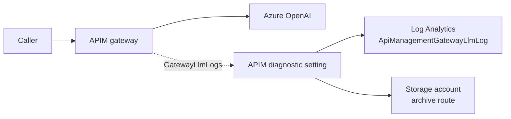

# Lab 08 — LLM logging audit trail

**Zone:** 🚪 Gateway · **Dimension:** D7 Observability & audit · **Evidence:** [evidence/26-apim-llmlog.txt](../evidence/26-apim-llmlog.txt)

---

## 🧒 In plain words

The guard keeps a logbook. The logbook records who came in, what they asked, what answer came back,
and how much they used. The logbook can go to a search desk or to a storage box.

## 🧠 The idea

APIM can log LLM requests, responses, and token counts. To get the rich resource-specific table,
create the APIM diagnostic setting with `--export-to-resource-specific true`. The table name is
`ApiManagementGatewayLlmLog`.

Prompt and response body logging is opt-in. The API diagnostic must enable
`largeLanguageModel.logs=enabled` and set request and response `messages=all`. New Log Analytics
tables can take 30 to 60 minutes or more before rows first appear.

Logs can also route to Storage. In this environment, organization policy locked the Storage account
with `publicNetworkAccess=Disabled` and `allowSharedKeyAccess=false`, so blob reads require a private
endpoint. The routing configuration itself was accepted; see
[evidence/27-llmlog-storage.txt](../evidence/27-llmlog-storage.txt).



## 🔬 Try it

Prereq: [setup](../setup/prerequisites.md) done and [APIM setup](../apim/apim-guide.md) done
(`$RG`, `$APIM`, `$LAW`).

**1. Create or reuse Log Analytics:**

```bash
az monitor log-analytics workspace create -g "$RG" -n "$LAW" -l "$LOC"

export APIM_ID=$(az apim show -n "$APIM" -g "$RG" --query id -o tsv)
export LAW_ID=$(az monitor log-analytics workspace show -g "$RG" -n "$LAW" --query id -o tsv)
```

**2. Send APIM GatewayLlmLogs to the resource-specific table:**

```bash
az monitor diagnostic-settings create \
  --name apim-llm-to-law \
  --resource "$APIM_ID" \
  --workspace "$LAW_ID" \
  --export-to-resource-specific true \
  --logs '[{"category":"GatewayLlmLogs","enabled":true}]'
```

**3. Enable the API diagnostic for LLM bodies and token data:**

```bash
export SUB_ID=$(az account show --query id -o tsv)

az rest --method put \
  --url "https://management.azure.com/subscriptions/$SUB_ID/resourceGroups/$RG/providers/Microsoft.ApiManagement/service/$APIM/apis/aoai/diagnostics/azuremonitor?api-version=2024-05-01" \
  --body '{
    "properties": {
      "alwaysLog": "allErrors",
      "verbosity": "information",
      "largeLanguageModel": { "logs": { "enabled": true } },
      "frontend": {
        "request":  { "body": { "bytes": 262144 }, "messages": "all" },
        "response": { "body": { "bytes": 262144 }, "messages": "all" }
      }
    }
  }'
```

**4. Send one request through APIM:**

```bash
export SVC_A_KEY=$(az rest --method post \
  --url "https://management.azure.com/subscriptions/$SUB_ID/resourceGroups/$RG/providers/Microsoft.ApiManagement/service/$APIM/subscriptions/sub-svc-a/listSecrets?api-version=2024-10-01-preview" \
  --query primaryKey -o tsv)

curl -sS "https://$APIM.azure-api.net/aoai/chat/completions" \
  -H "api-key: $SVC_A_KEY" \
  -H "Content-Type: application/json" \
  -d '{"messages":[{"role":"user","content":"Write one sentence about the ocean."}]}'
```

**5. Query the LLM log table:**

```bash
az monitor log-analytics query -w "$LAW" --analytics-query '
ApiManagementGatewayLlmLog
| where TimeGenerated > ago(2h)
| project TimeGenerated, DeploymentName, ModelName, PromptTokens, CompletionTokens,
          TotalTokens, Region, RequestMessages, ResponseMessages
| order by TimeGenerated desc
| take 10
' -o table
```

**6. Route the same log category to Storage:**

```bash
export ST=stllmlog$RANDOM
az storage account create -n "$ST" -g "$RG" -l "$LOC" --sku Standard_LRS
export ST_ID=$(az storage account show -n "$ST" -g "$RG" --query id -o tsv)

az monitor diagnostic-settings create \
  --name apim-llm-to-storage \
  --resource "$APIM_ID" \
  --storage-account "$ST_ID" \
  --logs '[{"category":"GatewayLlmLogs","enabled":true}]'
```

## 📊 What you'll see

```
=== APIM LLM logging -> Log Analytics (resource-specific table) ===
Table: ApiManagementGatewayLlmLog  | Diagnostic: --export-to-resource-specific true
API diagnostic largeLanguageModel.logs=enabled, requests/responses messages=all (max 262144 bytes)
-- Token-usage record --  DeploymentName: dep-a  ModelName: gpt-4.1-mini-2025-04-14
  PromptTokens: 14  CompletionTokens: 22  TotalTokens: 36  Region: koreacentral
-- Captured request --  [{"role":"user","content":"Write one sentence about the ocean."}]
-- Captured response -- {"role":"assistant","content":"The ocean is a vast and mysterious body of saltwater that covers over 70% of the Earth's surface."}
```

## ✅ Why it matters

- APIM gives a central audit trail for who called the model, what was sent, what came back, and how many tokens were used.
- The resource-specific table keeps LLM fields such as deployment, model, token counts, and messages queryable.
- Body logging is opt-in. Storing request and response bodies raises CMK, retention, and access-control decisions; see lab-11.
- Storage routing can archive logs, but locked-down storage may require private endpoint access to read blobs.

## 📎 Evidence

[evidence/26-apim-llmlog.txt](../evidence/26-apim-llmlog.txt) — live capture (2026-10-05): token counts and message bodies appeared in `ApiManagementGatewayLlmLog`; [evidence/27-llmlog-storage.txt](../evidence/27-llmlog-storage.txt) confirms Storage routing was accepted.

## 🧹 Cleanup

```bash
az monitor diagnostic-settings delete --name apim-llm-to-law --resource "$APIM_ID"
az monitor diagnostic-settings delete --name apim-llm-to-storage --resource "$APIM_ID"
az storage account delete -n "$ST" -g "$RG" --yes
```

## 📚 References

- [Monitor Azure API Management](https://learn.microsoft.com/en-us/azure/api-management/api-management-howto-use-azure-monitor)
- [ApiManagementGatewayLlmLog table](https://learn.microsoft.com/en-us/azure/azure-monitor/reference/tables/apimanagementgatewayllmlog)

*Confirmed 2026-10. Behavior verified live; cite Microsoft Learn for monitoring and the resource-specific table.*


