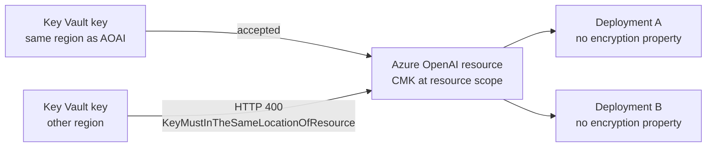

# Lab 11 — Customer-managed key region and scope

**Zone:** 🤖 Agent · **Dimension:** D6 Data protection & keys · **Evidence:** [evidence/28-cmk-region.txt](../evidence/28-cmk-region.txt)

---

## 🧒 In plain words

A customer-managed key is like a key for a safe. The key must be made in the same city as the safe.
Also, the safe is for the whole room, not for each desk. One Azure OpenAI resource has one CMK
setting; individual deployments do not have their own encryption setting.

## 🧠 The idea

Azure OpenAI CMK is configured on the account with `properties.encryption` and
`keySource=Microsoft.KeyVault`. A Key Vault key from another Azure region is rejected with
`KeyMustInTheSameLocationOfResource`. Deployment objects do not expose an encryption property.

If request and response body logging or storage is disabled, there may be no stored prompt or
completion content on that path that needs CMK. See [lab-03](lab-03-store-false-apim.md) for the
no-body-storage path.



## 🔬 Try it

Prereq: [setup](../setup/prerequisites.md) done (`$AOAI`, `$RG`, `$LOC`, `$DEP_A`). This lab changes
resource encryption settings. Run it only in a test resource.

**1. Create one same-region Key Vault and one other-region Key Vault:**

```bash
export KV_SAME="${KV}-same"
export KV_OTHER="${KV}-other"
export OTHER_LOC="japaneast"

az keyvault create -g "$RG" -n "$KV_SAME" -l "$LOC" --enable-purge-protection true
az keyvault create -g "$RG" -n "$KV_OTHER" -l "$OTHER_LOC" --enable-purge-protection true

az keyvault key create --vault-name "$KV_SAME" --name aoai-cmk --kty RSA --size 2048
az keyvault key create --vault-name "$KV_OTHER" --name aoai-cmk --kty RSA --size 2048

export KEY_SAME=$(az keyvault key show --vault-name "$KV_SAME" --name aoai-cmk --query key.kid -o tsv)
export KEY_OTHER=$(az keyvault key show --vault-name "$KV_OTHER" --name aoai-cmk --query key.kid -o tsv)
export AOAI_ID=$(az cognitiveservices account show -g "$RG" -n "$AOAI" --query id -o tsv)
```

**2. Give the Azure OpenAI resource identity access to the keys:**

```bash
az cognitiveservices account identity assign -g "$RG" -n "$AOAI"
export AOAI_PID=$(az cognitiveservices account show -g "$RG" -n "$AOAI" --query identity.principalId -o tsv)

for V in "$KV_SAME" "$KV_OTHER"; do
  az keyvault set-policy -n "$V" --object-id "$AOAI_PID" \
    --key-permissions get wrapKey unwrapKey
done
```

**3. Try the cross-region key first and expect HTTP 400:**

```bash
az rest --method patch --uri "https://management.azure.com$AOAI_ID?api-version=2024-10-01" \
  --headers Content-Type=application/json \
  --body "$(jq -n --arg key "$KEY_OTHER" '{properties:{encryption:{keySource:"Microsoft.KeyVault",keyVaultProperties:{keyIdentifier:$key}}}}')"
```

**4. Try the same-region key and expect success:**

```bash
az rest --method patch --uri "https://management.azure.com$AOAI_ID?api-version=2024-10-01" \
  --headers Content-Type=application/json \
  --body "$(jq -n --arg key "$KEY_SAME" '{properties:{encryption:{keySource:"Microsoft.KeyVault",keyVaultProperties:{keyIdentifier:$key}}}}')" \
  | jq '.properties.encryption.keySource'
```

**5. Inspect a deployment object:**

```bash
az cognitiveservices account deployment show \
  -g "$RG" -n "$AOAI" --deployment-name "$DEP_A" \
  | jq '.properties | keys'
```

## 📊 What you'll see

```
=== CMK region + scope ===
[1] Japan East Key Vault key -> Korea Central resource -> HTTP 400 "KeyMustInTheSameLocationOfResource"
[2] Korea Central Key Vault key -> same resource -> accepted; properties.encryption.keySource = Microsoft.KeyVault
[3] Deployment object has NO encryption property (only capabilities, model, raiPolicyName, rateLimits, scaleSettings) -> CMK is RESOURCE-level, not per-deployment.
Note: environment later locked both Key Vaults to publicNetworkAccess=Disabled; result stands from the original run.
```

## ✅ Why it matters

- CMK planning is done at the Azure OpenAI resource level, not per deployment.
- The Key Vault key must be in the same Azure region as the Azure OpenAI resource.
- If a path does not persist request or response bodies, CMK may not be required for that path.
  Confirm the logging and storage design before adding key-management complexity.

## 📎 Evidence

[evidence/28-cmk-region.txt](../evidence/28-cmk-region.txt) — cross-region key returned 400; same-region key was accepted; deployment object had no encryption property.

## 🧹 Cleanup

```bash
# Optional: restore Microsoft-managed keys for the test resource if your policy allows it.
az rest --method patch --uri "https://management.azure.com$AOAI_ID?api-version=2024-10-01" \
  --headers Content-Type=application/json \
  --body '{"properties":{"encryption":{"keySource":"Microsoft.CognitiveServices"}}}'

az keyvault delete -g "$RG" -n "$KV_SAME"
az keyvault delete -g "$RG" -n "$KV_OTHER"
```

## 📚 References

- [Configure customer-managed keys for Azure AI services](https://learn.microsoft.com/en-us/azure/ai-services/encryption/cognitive-services-encryption-keys-portal)
- [Azure Key Vault keys overview](https://learn.microsoft.com/en-us/azure/key-vault/keys/about-keys)

*Confirmed 2026-10. Region and scope behavior verified live; key policy requirements can vary by tenant configuration.*
